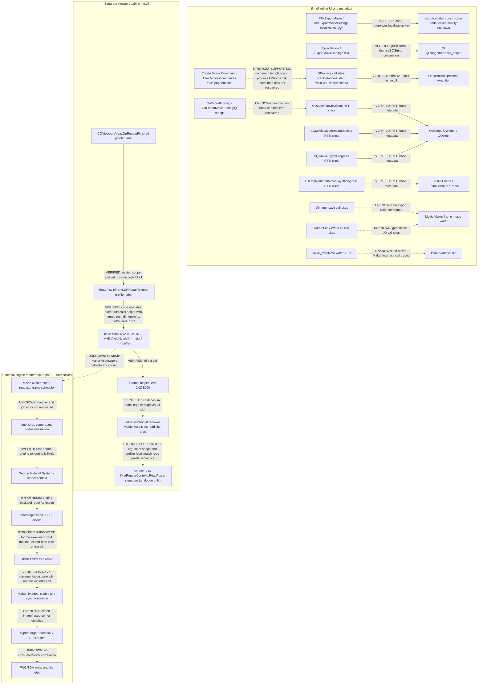

# SFM Movie Maker call graph: evidence-bounded reconstruction

This graph separates static code references, binary metadata, and hypothesized runtime flow. `VERIFIED` edges are directly represented by RTTI or disassembled instructions. `STRONGLY SUPPORTED` edges combine code shape with labels/API shape. Dotted edges are hypotheses or unresolved questions. The graph is not a claim that every edge executes during export.

## Reconstructed graph

## Edge ledger

| From → to | Classification | Evidence / limit |
|---|---|---|
| `#BxExportMovie` / `#BxExportMovieSettings` → resource/label-construction code | **VERIFIED** | Code pushes these localization-key addresses in `ifm.dll` at RVAs `0x2CF34E` / `0x2CF20E`. This is not a handler cross-reference. |
| `ExportMovie` / `ExportMovieSettings` string → Qt string conversion | **VERIFIED** | Code pushes each literal then calls imported `QString::fromAscii_helper` (`ExportMovie`: call at `0xAB8A7`; settings: `0xABBF6`). It supports literal/label use, not a function call. |
| `OnExportMovie()` → export handler | **UNKNOWN** | String is at RVA `0xAA0C63`; no direct pointer xref or exported symbol was recovered. Qt metadata may reference method names through offsets not found by this direct pointer scan. |
| export handler → `CQLayoffMovieDialog` / settings / progress classes | **UNKNOWN** | RTTI proves these classes exist and their base classes; no recovered call or constructor reference links them to `OnExportMovie()`. |
| `CQLayoffMovieDialog` / `CQMovieLayoffSettingsDialog` / `CQtMovieLayoffProgress` → Qt dialog bases | **VERIFIED** | Parsed MSVC RTTI class hierarchy metadata. |
| movie command labels/template → `QProcess` call sites | **STRONGLY SUPPORTED** | The command template includes `%9d.png` and MPEG-4 options; `ifm.dll` imports/calls Qt process APIs. No direct control-flow or argument-value link from template to the calls was recovered. |
| `ifm.dll` process call sites → Qt `QProcess` methods | **VERIFIED** | Direct IAT calls include `startDetached` at RVA `0x113015`, `start` at `0x113241`, `waitForFinished` at `0x11324E`, and stdout read at `0x11325A`. These call sites are statically present; execution for export is unverified. |
| `QImage::save` / `WriteFile` call sites → Movie Maker PNG frame writer | **UNKNOWN** | Imports and direct call sites exist, but their callers were not tied to Movie Maker export. |
| `valve_avi.dll` AVI write API → SFM Movie Maker | **UNKNOWN** | AVI writer APIs are imported by the module; no interface/call path from the editor was traced. |
| viewport outer profiler label → inner `ReadPixelsFromLDRResultTexture` scope | **VERIFIED** | Both labels are passed to `tier0.dll` profiling calls in the same `CQViewportArea` code block. These labels are not function symbols. |
| viewport block → buffer allocation and internal helper | **VERIFIED** | At `ifm.dll` RVA `0x1A1B10`–`0x1A1C29`, code computes width×height×4, allocates a buffer, then calls helper RVA `0x27E000` with seven stack args including target-like object, zero origin, dimensions, buffer and `0x0C`. |
| helper `0x27E000` → virtual method at vtable byte offset `0x34` | **VERIFIED** | Disassembly shows the helper obtaining an object and issuing a virtual call with six stack parameters; helper ends in `ret 0x1C`. The receiver's private interface name is unknown. |
| virtual method → `IMatRenderContext::ReadPixels`-like semantics | **STRONGLY SUPPORTED** | Six-parameter shape `(x,y,width,height,data,format)` and `ReadPixelsFromLDRResultTexture` label match the public SDK method shape. The private interface/vtable identity and format are not established. |
| viewport readback path → Movie Maker export path | **UNKNOWN** | No cross-reference from export strings/classes to the viewport block, no export trace, and no matching exported PNG were available. |
| SFM D3D9 runtime → DXVK → Vulkan | **STRONGLY SUPPORTED** for normal rendering in this examined environment; **UNKNOWN** for Movie Maker frame export | SFM is x86, D3D9 backend modules are present, and prior runtime evidence showed DXVK. No export-time target/readback trace exists. |
| Vulkan transfer/readback → output file | **UNKNOWN** | No exported image resource, staging buffer, synchronization chain or CPU consumer was correlated with an output PNG. |

## Most valuable next runtime experiment

Use a deterministic project with one selected frame, Image Sequence output and audio disabled. Under a read-only debugger/API trace, record call stacks and arguments for the viewport readback candidate, `QImage::save`, `WriteFile`, and D3D9/DXVK readback operations; then compare their execution during viewport-only rendering versus Movie Maker export. Decode the produced PNG and correlate dimensions and pixel values with candidate buffers. This single controlled experiment can decide whether Movie Maker reuses the viewport path, uses another Material System/D3D9 path, or writes through a separate pipeline.

Use RVAs only after validating the exact module fingerprint; addresses in a live process are `module base + RVA` and may differ because of ASLR. No observation points have been instrumented in this research phase.
