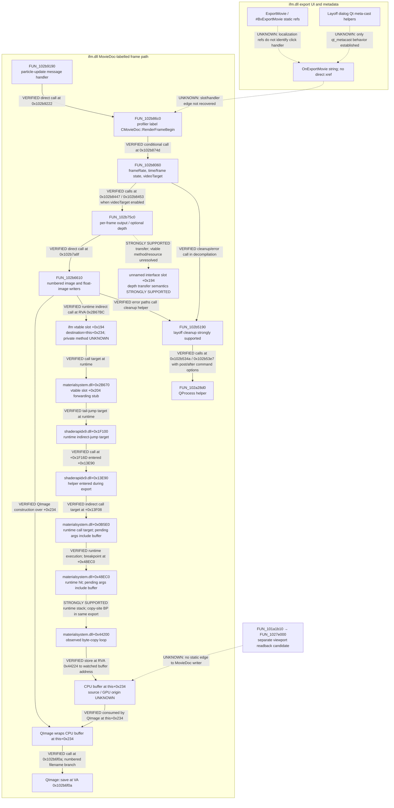
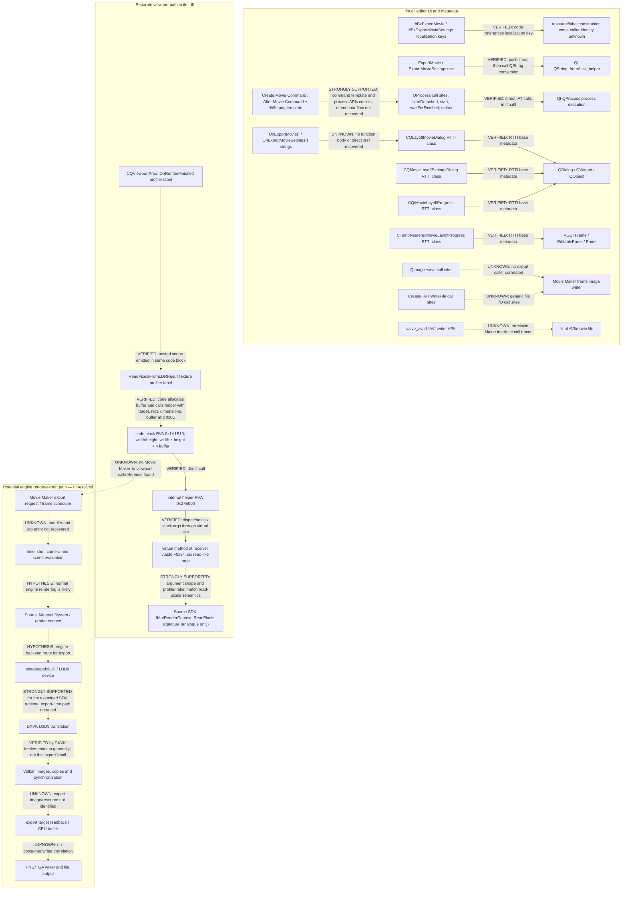

# SFM Movie Maker call graph: evidence-bounded reconstruction

**Runtime status (2026-11-01): export-time save, output and a Material System buffer write observed.** The Movie Maker path reached `QtGui4!QImage::save`, which returned `1` for `a3000000.png`; the user confirmed the file exists. In a later export, a hardware write watch on the writer's CPU buffer stopped in a `materialsystem.dll` byte-copy loop at RVA `0x44224`, with a stack through `shaderapidx9.dll` back to `ifm.dll+0x2B67BE` inside `FUN_102B6610`. A separate callsite breakpoint confirmed the interface slot's Material System forwarding stub tail-jumps to `shaderapidx9.dll+0x1F100`. The store and forwarding dispatch are verified; stack-unwinding warnings make deeper caller edges strongly supported. The source bytes' origin and whether this is GPU readback remain unknown. See [RUNTIME_TRACE_RESULTS.md](RUNTIME_TRACE_RESULTS.md) and [RUNTIME_TRACE_PLAN.md](RUNTIME_TRACE_PLAN.md).

This graph separates static code references, binary metadata, and hypothesized runtime flow. `VERIFIED` edges are directly represented by instructions/xrefs; `STRONGLY SUPPORTED` edges combine direct code shape with labels/options; dotted edges are hypotheses or unresolved questions. The static MovieDoc frame/output path below was added in Phase 3. It does not prove that the menu action reaches it at runtime. The Phase 2 graph is retained afterward for its earlier viewport/API findings; its generic image-writer uncertainty is superseded by the Phase 3 `FUN_102b6610` findings.

## Phase 3 graph: MovieDoc frame output

All addresses below are VAs in the fingerprinted x86 `ifm.dll` at image base `0x10000000`; subtract the base for RVA.

### Phase 3 edge ledger

| From → to | Classification | Evidence / limit |
|---|---|---|
| `FUN_102b9190` → `FUN_102b86c0` | **VERIFIED** | Direct call at `0x102b9222` after particle-update message handling succeeds. This does not identify an export-menu caller. |
| `FUN_102b86c0` → `FUN_102b8060` | **VERIFIED** | Direct conditional call at `0x102b874d`; function carries `CMovieDoc::RenderFrameBegin` profiler label. |
| `FUN_102b8060` → `FUN_102b75c0` | **VERIFIED** | Direct calls at `0x102b8447` and `0x102b8453`; branch checks `videoTarget`. |
| `FUN_102b75c0` → `FUN_102b6610` | **VERIFIED** | Direct call at `0x102b7a8f`. |
| `FUN_102b6610` → frame-number path and QImage writer | **VERIFIED** | Formats `"%s%06d%s.%s"`; wraps `this+0x234`; calls `QImage::save` at `0x102b6f0a` in `videoTarget` branches `5`/`8`. Mapping those values to a UI mode is **UNKNOWN**. |
| Movie Maker click/`OnExportMovie()` → MovieDoc frame functions | **UNKNOWN** | No body/xref/signal connection recovered for the string. Dialog-name functions are Qt meta-cast helpers, not handlers. |
| Movie Maker slot `+0x194` → Material System write into buffer | **STRONGLY SUPPORTED as interface-mediated pixel transfer; exact readback remains unknown** | The slot call at `ifm.dll` RVA `0x2B67BC` passes `this+0x234` as destination. Runtime stack from that call passes through `shaderapidx9.dll` to `materialsystem.dll+0x44200`, whose 4-byte-source/3-byte-destination loop wrote the watched byte. WinDbg unwind warnings limit deeper stack-edge confidence. GPU resource and synchronization are not identified. |
| optional depth interface call → transfer/read operation | **STRONGLY SUPPORTED** | Slot `DAT_10f4c774` +`0x194` receives rectangle-like args, buffer, `0x1d`, and stride; exact private method remains unknown. |
| `FUN_102b5190` → `FUN_102a28d0` external command helper | **VERIFIED** | Calls at `0x102b534a`/`0x102b53e7`, supplied with post-render and after-render command/argument options. Specific runtime command use is unobserved. |
| viewport readback path → MovieDoc image writer | **UNKNOWN** | No direct static edge; keep viewport and Movie Maker paths separate. |

## Phase 2 baseline graph (retained)

## Reconstructed graph

## Edge ledger

| From → to | Classification | Evidence / limit |
|---|---|---|
| `#BxExportMovie` / `#BxExportMovieSettings` → resource/label-construction code | **VERIFIED** | Code pushes these localization-key addresses in `ifm.dll` at RVAs `0x2CF34E` / `0x2CF20E`. This is not a handler cross-reference. |
| `ExportMovie` / `ExportMovieSettings` string → Qt string conversion | **VERIFIED** | Code pushes each literal then calls imported `QString::fromAscii_helper` (`ExportMovie`: call at `0xAB8A7`; settings: `0xABBF6`). It supports literal/label use, not a function call. |
| `OnExportMovie()` → export handler | **UNKNOWN** | String is at RVA `0xAA0C63`; no direct pointer xref or exported symbol was recovered. Qt metadata may reference method names through offsets not found by this direct pointer scan. |
| export handler → `CQLayoffMovieDialog` / settings / progress classes | **UNKNOWN** | RTTI proves these classes exist and their base classes; no recovered call or constructor reference links them to `OnExportMovie()`. |
| `CQLayoffMovieDialog` / `CQMovieLayoffSettingsDialog` / `CQtMovieLayoffProgress` → Qt dialog bases | **VERIFIED** | Parsed MSVC RTTI class hierarchy metadata. |
| movie command labels/template → `QProcess` call sites | **STRONGLY SUPPORTED** | The command template includes `%9d.png` and MPEG-4 options; `ifm.dll` imports/calls Qt process APIs. No direct control-flow or argument-value link from template to the calls was recovered. |
| `ifm.dll` process call sites → Qt `QProcess` methods | **VERIFIED** | Direct IAT calls include `startDetached` at RVA `0x113015`, `start` at `0x113241`, `waitForFinished` at `0x11324E`, and stdout read at `0x11325A`. These call sites are statically present; execution for export is unverified. |
| `QImage::save` / `WriteFile` call sites → Movie Maker PNG frame writer | **Phase 2: UNKNOWN; updated in Phase 3** | Phase 3 directly tied `FUN_102b6610` to a `QImage::save` call from a MovieDoc-labelled frame-output chain. The export-menu-to-frame edge and execution during an actual export remain unverified. |
| `valve_avi.dll` AVI write API → SFM Movie Maker | **UNKNOWN** | AVI writer APIs are imported by the module; no interface/call path from the editor was traced. |
| viewport outer profiler label → inner `ReadPixelsFromLDRResultTexture` scope | **VERIFIED** | Both labels are passed to `tier0.dll` profiling calls in the same `CQViewportArea` code block. These labels are not function symbols. |
| viewport block → buffer allocation and internal helper | **VERIFIED** | At `ifm.dll` RVA `0x1A1B10`–`0x1A1C29`, code computes width×height×4, allocates a buffer, then calls helper RVA `0x27E000` with seven stack args including target-like object, zero origin, dimensions, buffer and `0x0C`. |
| helper `0x27E000` → virtual method at vtable byte offset `0x34` | **VERIFIED** | Disassembly shows the helper obtaining an object and issuing a virtual call with six stack parameters; helper ends in `ret 0x1C`. The receiver's private interface name is unknown. |
| virtual method → `IMatRenderContext::ReadPixels`-like semantics | **STRONGLY SUPPORTED** | Six-parameter shape `(x,y,width,height,data,format)` and `ReadPixelsFromLDRResultTexture` label match the public SDK method shape. The private interface/vtable identity and format are not established. |
| viewport readback path → Movie Maker export path | **UNKNOWN** | No cross-reference from export strings/classes to the viewport block, no export trace, and no matching exported PNG were available. |
| SFM D3D9 runtime → DXVK → Vulkan | **STRONGLY SUPPORTED** for normal rendering in this examined environment; **UNKNOWN** for Movie Maker frame export | SFM is x86, D3D9 backend modules are present, and prior runtime evidence showed DXVK. No export-time target/readback trace exists. |
| Vulkan transfer/readback → output file | **UNKNOWN** | No exported image resource, staging buffer, synchronization chain or CPU consumer was correlated with an output PNG. |

## Most valuable next runtime experiment

Phase 2 recommended a generic export trace. Phase 3 narrows the experiment to `FUN_102b86c0`, `FUN_102b8060`, `FUN_102b75c0`, `FUN_102b6610`, and the `QImage::save` call at `ifm.dll+0x2B6F0A`, with a watch on the buffer at object offset `+0x234`; see [MOVIE_MAKER_STATIC_ANALYSIS.md](MOVIE_MAKER_STATIC_ANALYSIS.md) for the current procedure.

Use RVAs only after validating the exact module fingerprint; addresses in a live process are `module base + RVA` and may differ because of ASLR. No observation points have been instrumented in this research phase.
